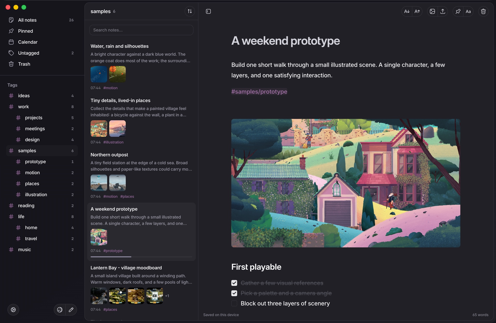

# Blot

Blot is a local-first notes app for macOS, Windows, and Linux. Write in rich text, organize notes with inline hashtags, and see scheduled checklist items on a calendar. Notes autosave to SQLite on your computer. You can use Blot offline from the first launch.

[Website](https://blot.page/) · [Report an issue](https://github.com/joduplessis/blot/issues)



## Run from source

Install Node.js 22.12 or newer and npm. From the repository root, run:

```sh
cd app
npm ci
npm --prefix desktop ci
npm run dev
```

This opens the Electron app with the local renderer. Choose **New note** or press **Cmd/Ctrl+N** to start writing. Press **Cmd/Ctrl+F** to search. The app uses the published Fold packages pinned in the lockfile.

| Command from `app/` | Result |
| --- | --- |
| `npm run typecheck` | Check renderer and desktop TypeScript |
| `npm run build` | Build the renderer and desktop services |
| `npm run electron` | Build and launch the production renderer locally |
| `npm run pack:mac`, `npm run pack:win`, or `npm run pack:linux` | Build an unpacked desktop app for the selected platform |

On Apple Silicon, `npm run pack:mac` produces `app/desktop/release/mac-arm64/Blot.app`. Copy it to Applications to install it.

## Writing and organizing

- Type `#garden` in a note to tag it or `#garden/seeds` to nest a tag. Select a tag in the sidebar to see its notes. Drag a note onto a tag to add it.
- Use the formatting menu or Markdown shortcuts for headings, lists, checkboxes, links, and code. Paste or drop an image into a note, or use the attachment button to add a file.
- Open the calendar beside a checklist item to give it a date, time, or repeat schedule. Scheduled tasks appear in **Calendar** and leave the calendar when checked off.
- Pin a note to keep it handy. Deleted notes go to **Trash**, where you can restore or permanently delete them.

## Notes, privacy, and backups

**Settings → Import / Export** reads Markdown files and exports unprotected notes with their images and attachments. Keep the exported media folders beside the Markdown files.

For a full backup, use **File → Back up notes**. Keep the SQLite backup and its companion `.sqlite.images` folder together. This includes protected notes and retained revisions. For a manual restore, quit Blot, move the existing database, its WAL/SHM files, and its `images/` folder aside together, then restore the backup as `noted.sqlite` and its companion files into `images/`. Reopen Blot.

Packaged macOS installations store the database at `~/Library/Application Support/Noted/noted.sqlite`. Other platforms use the `Noted` directory under the platform’s app-data folder. Development defaults to `app/desktop/.data/`. Set `BLOT_DATA_DIR` to an empty temporary directory to try Blot with a separate library.

**Settings → Privacy** lets you set a six-digit PIN and lock individual notes. Blot encrypts their bodies and revision history. Titles, tags, and dates remain visible. Remove attachments before protecting a note. Keep your PIN safe: it cannot be recovered, and older encrypted backups still need their original PIN.

## Optional folder sync

1. Create an empty folder for Blot in a location your file-sync client shares between computers.
2. On the first computer, open **Settings → Sync → Choose folder** and select it. Let your file-sync client finish uploading.
3. Choose the same folder on the other computer. Blot merges the two libraries and keeps competing edits as separate conflict notes. Use the same PIN on each device for protected notes.

Each device keeps its own SQLite database. Only the exchange folder belongs in the file-sync service. That folder retains revisions, including deleted content, so keep it private. Use **File → Back up notes** for independent backups.

## Website

The website source lives in `website/`. From the repository root:

```sh
cd website
npm ci
npm run dev
```

Open `http://127.0.0.1:4320` for development. Run `npm run build` from `website/` to type-check the site and regenerate the repository’s `docs/` directory. Use `npm run preview` to serve the production build locally.

Publish the generated `docs/` files with the website changes. In **Settings → Pages**, select **Deploy from a branch**, **main**, and **/docs**. Set the custom domain to `blot.page` and configure its DNS for GitHub Pages. The site uses relative asset URLs so the same build also works at `/blot/`. [GitHub Pages setup](https://docs.github.com/en/pages/getting-started-with-github-pages/configuring-a-publishing-source-for-your-github-pages-site)

## License

Blot’s source code is available under the [MIT License](LICENSE). The bundled Inter typeface uses the [SIL Open Font License](app/public/Inter-LICENSE.txt).
